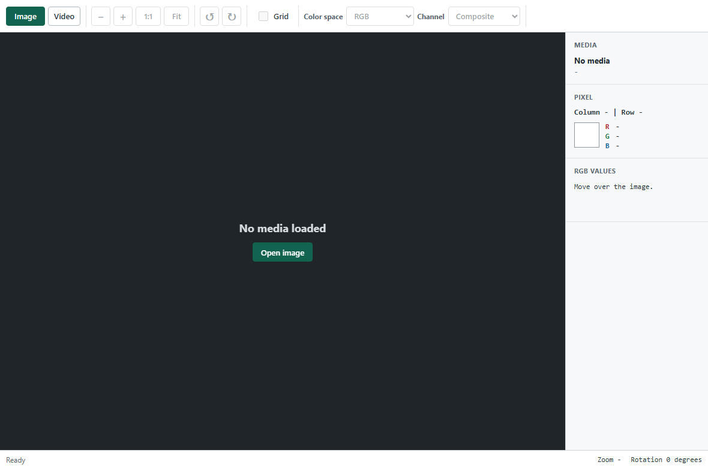
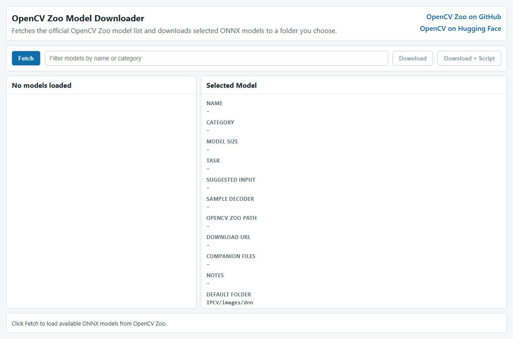

# IPCV: Image Processing and Computer Vision for Scilab

IPCV brings OpenCV image processing, computer vision and neural network inference to Scilab. The current development line is IPCV 5.1.0, built against OpenCV and OpenCV contrib 5.1.0. This maintenance branch targets **Scilab 2026.1** and loads its compiled help from `jar/`. For Scilab 2027, use [master](https://github.com/tanchinluh/IPCV/tree/master).

**Already have a binary?** [Install it with ATOMS](#install-a-binary). No compiler, Git checkout or separate OpenCV SDK is required. **Building IPCV yourself?** Start with [Build from source](#build-from-source), then follow the instructions for [Windows](#windows-x64), [Ubuntu](#ubuntu-linux) or [macOS](#macos).

## Install a binary

1. Install [Scilab](https://www.scilab.org/download) for your operating system and CPU.
2. Get an IPCV **binary** archive built for that Scilab release, OS and architecture. Check [GitHub Releases](https://github.com/tanchinluh/IPCV/releases) or the [Scilab ATOMS catalog](https://atoms.scilab.org/toolboxes/IPCV), or use the archive supplied by your package maintainer. A GitHub *Source code* download is not an ATOMS binary.
3. In the **Scilab GUI console**, run the following and select the archive **without extracting it**:

```scilab
archive = uigetfile();
atomsInstall(archive, "user");
atomsLoad("IPCV");
```

You can also pass the full archive path directly. For example, for a supplied Windows 5.1.0 build:

```scilab
atomsInstall("C:/Downloads/IPCV_5.1.0.bin.x64.Windows.zip", "user");
atomsLoad("IPCV");
```

| Platform | Which archive to select |
| --- | --- |
| Windows x64 | The `.bin.x64.Windows.zip` built for your Scilab release. |
| Ubuntu / Linux | The `.Linux.tar.gz` for your CPU and a compatible Linux runtime. A build for one distribution is not guaranteed to run on another. |
| macOS | A `.Darwin.tar.gz` built for your Scilab release and architecture (Apple Silicon or Intel). If none is supplied, build from source. |

If the ATOMS catalog offers the release you want for your Scilab installation, `atomsInstall("IPCV", "user")` installs it by name. To install a **specific supplied build**, use its file path instead: the IPCV version in the filename alone does not identify the Scilab version it was compiled with.

### Verify the installation

In Scilab, check which toolbox copy is loaded, read a bundled image and open its help:

```scilab
disp(getIPCVpath());
disp(ipcv_version());
image = imread(fullfile(getIPCVpath(), "images", "baboon.png"));
imshow(image);
help imread
```

## What you can do

| Category | Functions and workflows |
| --- | --- |
| Image I/O and display | Read, write and inspect images with `imread`, `imwrite`, `imreadmulti`, `imshow` and `imtool`. |
| Color, filtering and enhancement | Convert color spaces, denoise and adjust contrast with `rgb2gray`, `imgaussianblur`, `imwiener2` and `imadapthistequal`. |
| Segmentation, morphology and measurement | Threshold an image, clean a mask and measure objects with `imbinarize`, `imfillholes`, `imconnectedcomponents` and `imregionprops`. |
| Geometry, registration and features | Detect and match features with `imdetect`, `imextract` and `immatch`; align images with `imphasecorr` and compare with `imfuse`. |
| Video, cameras and tracking | Capture frames with `camopen` and `camread`; write video with `avifile` and `aviaddframe`. Explore playback and optical flow in `imtool`. |
| Deep learning | Import models with `dnn_readmodel`, preprocess with `dnn_forward_preset`, and read named final outputs with `dnn_forward_outputs`. |
| 3-D images and DICOM | Read uncompressed grayscale DICOM data with `dicomread`, inspect slices with `dicomshow`, and render or process volumes with `volshow`. |

See the [capability map](CAPABILITIES.md) for coverage by category and the [demos](demos/) for runnable workflows.

**Coordinates:** IPCV image coordinates `[x y]` mean column and row from the **upper left**. Scilab plots use Cartesian coordinates from the **lower left**. Use `rect2cart` or `sub2cart` before drawing plot overlays on an image.

**Naming:** Prefer the active IPCV names in the help (for example, `immat2gray`, `imbwareaopen` and `imlabel2rgb`). Archived implementations in [macros/old](macros/old/) are not built into the macro library. The `avi...`, `cam...` and `dnn_...` families retain their own prefixes.

### Interactive tools and models

| Image and video inspector: `imtool()` | Model browser: `opencv_zoo_gui()` |
| --- | --- |
|  |  |
| Inspect pixel values, pause on a video frame, and record analysis such as optical flow. Video decoding depends on the codecs in the OpenCV build. | Browse models by category and size, download a model, or generate a starter script and open it in the Scilab editor. |

The volume viewer, `volshow(volume)`, provides slice and 3-D views, voxel spacing controls and volume processing. The bundled [DICOM sample and its license](images/dicom/) can be used without downloading a dataset.

Large models download on demand; the small bundled `lenet5.onnx` supports offline regression tests. For worked examples, see [classification, YOLOX, SSD and segmentation](demos/demo_dnn_full_examples.sci) and [CLIP zero-shot classification](demos/demo_dnn_clip.sci). With OpenCV 5.1's graph engine, named **final** outputs are supported; intermediate activations and learned parameters are not exposed for ONNX/TFLite models on that engine.

## Build from source

Install the [Scilab distribution](https://www.scilab.org/download) you intend to run, and Git. Clone to a writable directory; use a path without spaces for the Unix third-party build script. From a terminal:

```sh
git clone --branch IPCV5.1-Scilab2026 https://github.com/tanchinluh/IPCV.git
cd IPCV
```

Follow **one** platform section, then [build and load IPCV](#build-and-load-ipcv). If the matching OpenCV **SDK** (headers and libraries, not just the runtime archive) is already installed under this checkout's `thirdparty` directory, skip the OpenCV build.

### Windows x64

1. Install Visual Studio 2022 Build Tools with **Desktop development with C++**, the x64 MSVC toolchain and a Windows SDK. Make sure `cmake`, `ninja`, `curl` and `tar` are on the command prompt's PATH.
2. Open **x64 Native Tools Command Prompt for VS 2022**. In the cloned IPCV root, run:

```bat
set "IPCV_ROOT=%CD%"
pushd thirdparty\build
call build.bat
popd
```

3. Check the build log for errors. The installed SDK should contain `thirdparty\Windows\AMD64\include\opencv2\core.hpp` and `thirdparty\Windows\AMD64\lib\opencv_world510.lib`. From the **same native tools prompt**, launch the target Scilab (adjust the path to your installation):

```bat
"C:\Tools\scilab-2026.1.0\bin\WScilex.exe" -noatomsautoload
```

### Ubuntu Linux

1. Install the build tools. Include GTK development headers **before configuring OpenCV** if you want native HighGUI windows as well as Scilab graphics.

```sh
sudo apt update
sudo apt install build-essential gfortran git ca-certificates cmake ninja-build \
  curl make pkg-config tar xz-utils libgtk-3-dev
```

2. Download and unpack the official Linux Scilab archive. Set `SCILAB_BIN` to its actual `bin` directory (the one containing `scilab` and `scilab-adv-cli`). From the IPCV root:

```sh
export IPCV_ROOT="$PWD"
export SCILAB_BIN="/absolute/path/to/scilab-2026.1.0/bin"
(cd thirdparty/build && bash ./build.sh)
ls "thirdparty/Linux/$(uname -m)/lib/libopencv_world.so"
"$SCILAB_BIN/scilab" -noatomsautoload
```

The script builds shared FFmpeg first, then OpenCV and OpenCV contrib. For command-line tests that use graphics, run `scilab-adv-cli` in a desktop session, not the no-GUI `scilab-cli`.

### macOS

1. Install the Scilab application for your CPU in `/Applications`. Use a terminal and compiler toolchain of the same architecture as Scilab; do not mix an Intel Scilab process with ARM64 libraries.
2. Install Apple's Command Line Tools with `xcode-select --install` and complete the installer. With [Homebrew](https://brew.sh/) available, install the other build tools:

```sh
brew install cmake ninja pkg-config gcc
```

3. From the IPCV root, build the dependencies and start Scilab from that terminal. Adjust the app path to match the installed bundle:

```sh
export IPCV_ROOT="$PWD"
export SCILAB_BIN="/Applications/scilab-2026.1.0.app/Contents/bin"
(cd thirdparty/build && bash ./build.sh)
ls "thirdparty/Darwin/$(uname -m)/lib/libopencv_world.dylib"
"$SCILAB_BIN/scilab-adv-cli" -noatomsautoload
```

The Unix script installs libraries for the current architecture. On macOS it configures a runtime search path under the build prefix: verify a redistributed archive on a **different Mac** rather than assuming a successful local build is relocatable.

### Build and load IPCV

In the Scilab process started above, run:

```scilab
cd(getenv("IPCV_ROOT"));
exec("builder.sce", -1);
exec("loader.sce", -1);
disp(ipcv_version());
```

Only run the loader after the builder finishes successfully. The builder compiles the macros, C++ core and gateway, builds the help, and generates the loader. Stop at the **first compiler or linker error**; a loader left over from an older build does not prove the new build succeeded. For build flags and library layouts see the [third-party build guide](thirdparty/build/README.txt).

## Test and distribute

**Test the copy you intend to ship.** In a build or package from this branch, run the focused stability suite from Scilab:

```scilab
exec(fullfile(getIPCVpath(), "tests", "run_stability_tests.sce"), -1);
```

Alternatively, run the broader `release` suite from the toolbox root:

```powershell
# Windows PowerShell
.\tests\run_tests.ps1 -ScilabExecutable "C:\Tools\scilab-2026.1.0\bin\WScilex-cli.exe" -Suite release
```

```sh
# Ubuntu or macOS, with SCILAB_BIN set as above
sh ./tests/run_tests.sh "$SCILAB_BIN/scilab-adv-cli" release
```

The release suite covers core and local integration tests. The GUI, network and hardware suites can be selected separately. Active tests live in [tests/unit_tests](tests/unit_tests/); the legacy IPCV 4.5 tests are historical references, not part of the default run. See the [test guide](tests/README.md) for individual tests, reports and timeouts.

**Package an existing build** from the IPCV root in Scilab:

```scilab
exec("makedist.sce", -1);
```

On this branch, this writes to `dist/`: a ZIP on Windows or a tar.gz on Linux/macOS. It does not rebuild or run tests. It also queries ATOMS and may refresh the local `DESCRIPTION`; review that file before publishing. Keep artifacts for different Scilab releases separate even when their IPCV filenames match. Test a finished archive by installing it with ATOMS on a clean machine and running the stability suite **from the installed copy**.

The separate [Windows release batch file](make_release.bat) rebuilds from a clean, committed checkout, runs release checks, and produces a ZIP and SHA-256 checksum. It defaults to Scilab 2026.1 and its staging script requires the generated `jar/` help directory.

## Project resources

- [Capability map](CAPABILITIES.md): supported categories and gaps.
- [Roadmap](ROADMAP.md): numbered development steps within an OpenCV baseline. IPCV package versions follow the baseline, not each individual step.
- [Change log](ChangeLog.txt): release history, migrations and function changes.
- [Scilab macros](macros/), [gateways](sci_gateway/cpp/), [C++ implementation](src/cpp/) and [help sources](help/en_US/).
- [License](LICENSE): GNU General Public License; see individual source and sample-data notices for their terms.
